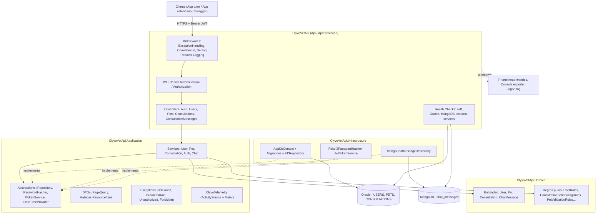

# ClyvoVet API — Entrega Final (Sprint 4)

**Advanced Business Development with .NET** | FIAP 2026 | Challenge Clyvo Vet | Equipe Harpi

API RESTful em ASP.NET Core 8 para o **ClyvoVet**, plataforma de cuidados veterinários com experiência para **tutores** e **veterinários** e **chat interno** por consulta. Esta entrega consolida as Sprints 1, 2 e 3 e adiciona: **Clean Architecture em 4 projetos**, **autenticação JWT**, **paginação, ordenação, filtros e HATEOAS**, **persistência relacional (Oracle + EF Core Migrations) e NoSQL (MongoDB)**, além de monitoramento, observabilidade e testes automatizados.

---

## Integrantes do Grupo

| Nome | RM |
|------|----|
| Ana Clara de Oliveira Nascimento | 561957 |
| Henrique Pereira | 565608 |
| Isis Macedo | 561497 |
| Rafael Carvalho Meireles | 563413 |

---

## Sumário

1. [Visão geral](#visão-geral)
2. [Arquitetura](#arquitetura)
3. [Autenticação e autorização (JWT)](#autenticação-e-autorização-jwt)
4. [Paginação, ordenação, filtros e HATEOAS](#paginação-ordenação-filtros-e-hateoas)
5. [Persistência: Oracle (EF Core) e MongoDB](#persistência-oracle-ef-core-e-mongodb)
6. [Endpoints](#endpoints)
7. [Regras de negócio](#regras-de-negócio-domain)
8. [Monitoramento e observabilidade](#monitoramento-e-observabilidade)
9. [Instalação e execução](#instalação-e-execução)
10. [Testes](#testes)
11. [Documentação Swagger/OpenAPI](#documentação-swaggeropenapi)
12. [Decisões de design e limitações](#decisões-de-design-e-limitações)

---

## Visão geral

| Tópico (enunciado) | Como foi atendido |
|--------------------|-------------------|
| Arquitetura e qualidade de código | 4 projetos (`Domain`, `Application`, `Infrastructure`, `Api`) com dependências apontando para dentro; SOLID; DI; `ExceptionHandlingMiddleware` global |
| API RESTful completa | Swagger com esquema Bearer; paginação/ordenação/filtros; HATEOAS; JWT com roles |
| Persistência relacional e NoSQL | EF Core + Oracle com Migrations; MongoDB para o chat; padrão Repository com implementações concretas |
| Monitoramento, observabilidade e testes | Health Checks (`/health*`), Serilog, OpenTelemetry (+ Prometheus), 156 testes xUnit no padrão AAA |
| Documentação | Este README, diagrama de arquitetura, `docs/swagger.json` exportado |

---

## Arquitetura

### Diagrama de camadas (Clean Architecture)



**Legenda:** setas contínuas = fluxo de chamada em tempo de execução; setas tracejadas "implementa" = inversão de dependência (a Infraestrutura implementa interfaces definidas na Application).

### Regra de dependência

```
Api ──► Application ──► Domain
 │                        ▲
 └────► Infrastructure ───┘   (Infrastructure também referencia Application para implementar as interfaces)
```

- **Domain** não depende de nada.
- **Application** depende só de Domain. Define as interfaces (`IUserRepository`, `IChatMessageRepository`, `IPasswordHasher`, `ITokenService`...) e contém os casos de uso.
- **Infrastructure** implementa essas interfaces (EF Core/Oracle, MongoDB, PBKDF2, JWT).
- **Api** compõe tudo (DI em `Program.cs`) e expõe HTTP.

### Estrutura de pastas

```
ClyvoVetApi.sln
├── ClyvoVetApi.Domain/
│   ├── Models/                 User, Pet, Consultation, ChatMessage
│   └── Rules/                  UserRoles, UserValidationRules, PetValidationRules,
│                               ConsultationStatuses, ConsultationSchedulingRules
├── ClyvoVetApi.Application/
│   ├── Abstractions/           Interfaces de repositório, IPasswordHasher, ITokenService, IDateTimeProvider
│   ├── Common/                 PageQuery, PagedResult, filtros, SortValidator
│   ├── DTOs/                   Create/Update DTOs, Login/Token, Resource/Link/PagedResponse
│   ├── Exceptions/             NotFound, BusinessRule, UnauthorizedApp, ForbiddenApp
│   ├── Observability/          ClyvoTelemetry
│   └── Services/               User, Pet, Consultation, Auth, Chat
├── ClyvoVetApi.Infrastructure/
│   ├── Data/                   AppDbContext (EF Core)
│   ├── Migrations/             InitialCreate, AddUserPasswordHash
│   ├── Repositories/           EfUserRepository, EfPetRepository, EfConsultationRepository
│   ├── Mongo/                  MongoChatMessageRepository (+ InMemory para testes)
│   └── Security/               Pbkdf2PasswordHasher, JwtTokenService
├── ClyvoVetApi/                (Api - ponto de entrada)
│   ├── Controllers/            Auth, Users, Pets, Consultations, ConsultationMessages, ApiControllerBase
│   ├── Infrastructure/         Middleware (Correlation, ExceptionHandling), HealthChecks (Mongo, ExternalService)
│   ├── Program.cs              Composição: DI, JWT, Swagger, Health Checks, Serilog, OpenTelemetry
│   └── Dockerfile
├── ClyvoVetApi.Tests.Unit/     Domain, Application, Infrastructure (xUnit + Moq + FluentAssertions)
├── ClyvoVetApi.Tests.Integration/  WebApplicationFactory (JWT, paginação, HATEOAS, chat, health)
├── docker-compose.yml          API + Oracle XE + MongoDB
└── docs/swagger.json           Contrato OpenAPI exportado
```

### SOLID e Clean Code (exemplos concretos)

| Princípio | Onde |
|-----------|------|
| **S** — Responsabilidade única | Controllers só traduzem HTTP; Services orquestram casos de uso; `Domain/Rules` guarda regras puras; `Pbkdf2PasswordHasher` só faz hash |
| **O** — Aberto/fechado | Trocar Mongo por outro armazenamento = nova implementação de `IChatMessageRepository` (já existe a `InMemoryChatMessageRepository`), sem tocar em `ChatService` |
| **L** — Substituição de Liskov | `MongoChatMessageRepository` e `InMemoryChatMessageRepository` são intercambiáveis |
| **I** — Segregação de interfaces | Interfaces pequenas e específicas: `IPasswordHasher`, `ITokenService`, `IDateTimeProvider`, um repositório por agregado |
| **D** — Inversão de dependência | Application define as interfaces; Infrastructure as implementa; DI registra em `Program.cs` |
| Clean Code | Nomes em português de negócio, métodos curtos, sem `try/catch` nos controllers, sem números/strings mágicos nas regras |

### Tratamento global de exceções

`ExceptionHandlingMiddleware` é o middleware mais externo do pipeline e converte exceções de negócio em respostas padronizadas (`ApiErrorResponse` com `CorrelationId`):

| Exceção | HTTP |
|---------|------|
| `NotFoundException` | 404 |
| `BusinessRuleException` | 400 |
| `UnauthorizedAppException` | 401 |
| `ForbiddenAppException` | 403 |
| qualquer outra | 500 (mensagem genérica; detalhes só no log) |

---

## Autenticação e autorização (JWT)

1. **Cadastre-se** (anônimo): `POST /api/users` informando `password` (6 a 100 caracteres). A senha é armazenada como **hash PBKDF2-HMAC-SHA256** (salt aleatório, 100.000 iterações) e **nunca** volta nas respostas.
2. **Faça login**: `POST /api/auth/login` com `{ "email": "...", "password": "..." }` → retorna `accessToken` (JWT HS256, claims `sub`, `email`, `name`, `role`, `jti`).
3. **Chame os endpoints** com `Authorization: Bearer {accessToken}`.

| Recurso | Regra de acesso |
|---------|-----------------|
| `POST /api/auth/login` | Anônimo |
| `POST /api/users` (cadastro) | Anônimo |
| Demais endpoints de Users, Pets, Consultations e mensagens | Qualquer usuário autenticado |
| `DELETE /api/consultations/{id}` | Somente role **Veterinario** (403 para Tutor) |
| `POST /api/consultations/{id}/messages` | Somente o **veterinário da consulta** ou o **tutor do pet**; o remetente vem do JWT (não do corpo) |

Mensagem de erro de login é única para e-mail inexistente, usuário sem senha ou senha errada (não revela quais e-mails existem). Chave JWT: `Jwt:Key` (mínimo 32 caracteres) — **defina por variável de ambiente/User Secrets em produção**.

---

## Paginação, ordenação, filtros e HATEOAS

Todas as listagens principais aceitam: `page` (≥1), `pageSize` (1–100, padrão 10), `sortBy` e `desc`.

| Endpoint | `sortBy` aceito | Filtros |
|----------|-----------------|---------|
| `GET /api/users` | id, name, email, role, createdAt | `role`, `search` (nome) |
| `GET /api/pets` | id, name, species, breed, weightKg | `tutorId`, `species`, `breed`, `search` |
| `GET /api/consultations` | id, consultationDate, status, createdAt | `petId`, `vetId`, `status`, `from`, `to` |
| `GET /api/consultations/{id}/messages` | ordem cronológica (`desc=true` inverte) | — |

Parâmetros inválidos retornam **400** (`page=0`, `pageSize=101`, `sortBy` fora da lista).

Exemplo — `GET /api/users?role=Tutor&page=2&pageSize=2&sortBy=name`:

```json
{
  "items": [
    {
      "data": { "id": 7, "name": "Maria", "email": "maria@test.com", "role": "Tutor", "createdAt": "2026-11-01T12:00:00Z" },
      "links": [
        { "rel": "self",   "href": "https://host/api/users/7", "method": "GET" },
        { "rel": "update", "href": "https://host/api/users/7", "method": "PUT" },
        { "rel": "delete", "href": "https://host/api/users/7", "method": "DELETE" },
        { "rel": "pets",   "href": "https://host/api/pets?tutorId=7", "method": "GET" }
      ]
    }
  ],
  "page": 2, "pageSize": 2, "totalItems": 5, "totalPages": 3,
  "links": [
    { "rel": "self",  "href": "https://host/api/users?role=Tutor&page=2&pageSize=2&sortBy=name", "method": "GET" },
    { "rel": "first", "href": "https://host/api/users?role=Tutor&page=1&pageSize=2&sortBy=name", "method": "GET" },
    { "rel": "prev",  "href": "https://host/api/users?role=Tutor&page=1&pageSize=2&sortBy=name", "method": "GET" },
    { "rel": "next",  "href": "https://host/api/users?role=Tutor&page=3&pageSize=2&sortBy=name", "method": "GET" },
    { "rel": "last",  "href": "https://host/api/users?role=Tutor&page=3&pageSize=2&sortBy=name", "method": "GET" }
  ]
}
```

**HATEOAS** nos endpoints de consulta: `GET /{id}` devolve `{ data, links }`; cada item de lista traz seus links; a coleção traz links de navegação. Relações por recurso:

| Recurso | Links |
|---------|-------|
| User | self, update, delete, `pets` (Tutor) ou `consultations` (Veterinário) |
| Pet | self, update, delete, `tutor`, `consultations` |
| Consultation | self, update, delete, `pet`, `vet`, `messages` |

---

## Persistência: Oracle (EF Core) e MongoDB

| Dado | Banco | Motivo |
|------|-------|--------|
| Usuários, Pets, Consultas | **Oracle** via EF Core (`Oracle.EntityFrameworkCore`) | Dados relacionais com integridade referencial (FKs) |
| Mensagens do chat | **MongoDB** (`MongoDB.Driver`) | Dado append-only, de alto volume, consultado só por consulta + tempo, sem joins |

**EF Core Migrations** (projeto `ClyvoVetApi.Infrastructure`):

| Migration | Conteúdo |
|-----------|----------|
| `InitialCreate` | Tabelas `USERS`, `PETS`, `CONSULTATIONS` |
| `AddUserPasswordHash` | Coluna `USERS.PASSWORD_HASH` (autenticação) |

```bash
# aplicar no banco configurado
dotnet ef database update --project ClyvoVetApi.Infrastructure --startup-project ClyvoVetApi
```

**Padrão Repository** (interfaces na Application, implementações concretas na Infrastructure):

| Interface | Implementação |
|-----------|---------------|
| `IUserRepository` | `EfUserRepository` |
| `IPetRepository` | `EfPetRepository` |
| `IConsultationRepository` | `EfConsultationRepository` |
| `IChatMessageRepository` | `MongoChatMessageRepository` (produção) / `InMemoryChatMessageRepository` (testes) |

O `MongoChatMessageRepository` cria o índice composto `(ConsultationId, SentAt)` e faz o mapeamento BSON na Infraestrutura, mantendo o Domain livre de dependências do driver.

---

## Endpoints

> 🔒 = exige `Authorization: Bearer {token}`. Contrato completo em [`docs/swagger.json`](docs/swagger.json) e na UI do Swagger (raiz `/`).

### Autenticação

| Método | Rota | Descrição |
|--------|------|-----------|
| POST | `/api/auth/login` | Retorna o token JWT |

### Usuários (`/api/users`)

| Método | Rota | Descrição |
|--------|------|-----------|
| GET 🔒 | `/api/users` | Lista paginada (filtros `role`, `search`; ordenação) |
| GET 🔒 | `/api/users/{id}` | Busca por ID (com links HATEOAS) |
| GET 🔒 | `/api/users/role/{role}` | Filtra por papel |
| GET 🔒 | `/api/users/search/{name}` | Busca por nome |
| GET 🔒 | `/api/users/email/{email}` | Busca por e-mail |
| POST | `/api/users` | Cadastra usuário (anônimo) |
| PUT 🔒 | `/api/users/{id}` | Atualiza |
| DELETE 🔒 | `/api/users/{id}` | Remove |

### Pets (`/api/pets`)

| Método | Rota | Descrição |
|--------|------|-----------|
| GET 🔒 | `/api/pets` | Lista paginada (filtros `tutorId`, `species`, `breed`, `search`) |
| GET 🔒 | `/api/pets/{id}` | Busca por ID (HATEOAS) |
| GET 🔒 | `/api/pets/tutor/{tutorId}` | Pets de um tutor |
| GET 🔒 | `/api/pets/species/{species}` | Filtra por espécie |
| GET 🔒 | `/api/pets/breed/{breed}` | Filtra por raça |
| GET 🔒 | `/api/pets/search/{name}` | Busca por nome |
| POST 🔒 | `/api/pets` | Cria pet |
| PUT 🔒 | `/api/pets/{id}` | Atualiza |
| DELETE 🔒 | `/api/pets/{id}` | Remove |

### Consultas (`/api/consultations`)

| Método | Rota | Descrição |
|--------|------|-----------|
| GET 🔒 | `/api/consultations` | Lista paginada (filtros `petId`, `vetId`, `status`, `from`, `to`) |
| GET 🔒 | `/api/consultations/{id}` | Busca por ID (HATEOAS) |
| GET 🔒 | `/api/consultations/pet/{petId}` | Consultas de um pet |
| GET 🔒 | `/api/consultations/vet/{vetId}` | Consultas de um veterinário |
| GET 🔒 | `/api/consultations/status/{status}` | Por status |
| GET 🔒 | `/api/consultations/period?startDate=&endDate=` | Por período |
| POST 🔒 | `/api/consultations` | Agenda consulta |
| PUT 🔒 | `/api/consultations/{id}` | Atualiza (inclusive status) |
| DELETE 🔒 (Veterinario) | `/api/consultations/{id}` | Remove |

### Chat da consulta (MongoDB)

| Método | Rota | Descrição |
|--------|------|-----------|
| GET 🔒 | `/api/consultations/{id}/messages` | Mensagens paginadas, em ordem cronológica |
| POST 🔒 | `/api/consultations/{id}/messages` | Envia mensagem (`{ "content": "..." }`); remetente = usuário do token |

### Operação / monitoramento

| Método | Rota | Descrição |
|--------|------|-----------|
| GET | `/health` | Status geral |
| GET | `/health/ready` | Readiness: Oracle, MongoDB, serviços externos |
| GET | `/health/live` | Liveness |
| GET | `/metrics` | Métricas Prometheus (fora do ambiente Testing) |

---

## Regras de negócio (Domain)

| Regra | Onde vive | Onde é aplicada |
|-------|-----------|-----------------|
| Role deve ser "Tutor" ou "Veterinario" | `UserRoles.IsValid` | `UserService.CreateAsync` |
| E-mail não pode se repetir | `IUserRepository.EmailExistsAsync` | `UserService.CreateAsync/UpdateAsync` |
| Veterinário precisa de CRMV | `UserValidationRules.HasValidCrmv` | `UserService.CreateAsync/UpdateAsync` |
| Tutor do pet precisa existir e ter role Tutor | `UserRoles.IsTutor` | `PetService.CreateAsync` |
| Data de nascimento do pet não pode ser futura | `PetValidationRules.IsBirthDateValid` | `PetService` |
| Peso do pet deve ser maior que zero | `PetValidationRules.IsWeightValid` | `PetService` |
| Consulta não pode ser agendada no passado | `ConsultationSchedulingRules.IsFutureOrPresent` | `ConsultationService` |
| Veterinário não pode ter duas consultas com menos de 30 min de intervalo | `ConsultationSchedulingRules.HasConflict` | `ConsultationService` |
| Consulta Realizada/Cancelada não pode mais ser alterada | `ConsultationStatuses.CanTransition` | `ConsultationService.UpdateAsync` |
| Só o veterinário da consulta ou o tutor do pet conversam no chat | `ChatService.EnsureParticipantAsync` | `ChatService.SendAsync` |
| Campo de ordenação deve estar na lista permitida | `SortValidator` | `*Service.GetPagedAsync` |

---

## Monitoramento e observabilidade

### Health Checks

| Endpoint | Checks |
|----------|--------|
| `GET /health` | todos |
| `GET /health/ready` | `oracle-db`, `mongodb`, `external-services` (tag `ready`) |
| `GET /health/live` | `self` (tag `live`) |

`external-services` verifica uma URL externa opcional (`HealthChecks:ExternalService:Url`); vazia = `Healthy` sem chamada. `mongodb` faz `ping` com timeout de 3 s e reporta `Degraded` se indisponível. Resposta em JSON (`UIResponseWriter`).

### Logging estruturado (Serilog)

- Console e arquivo diário `Logs/clyvovet-YYYYMMDD.log`.
- **Correlation Id** por requisição (`X-Correlation-Id`, reaproveitado ou gerado), presente em todos os logs, na resposta, no erro padronizado e na tag do trace.
- Enrichers: `MachineName`, `ThreadId`; `UseSerilogRequestLogging` para o resumo HTTP.

### Tracing e métricas (OpenTelemetry)

- Instrumentação automática: ASP.NET Core, HttpClient, Runtime.
- Instrumentação própria (`ClyvoTelemetry`): um span por caso de uso e métricas `clyvovet.business_rule.violations` e `clyvovet.application.operation.duration`.
- Exportadores: Console e Prometheus (`GET /metrics`).
- Tracing, métricas e `/metrics` ficam desligados em `ASPNETCORE_ENVIRONMENT=Testing` para manter os testes rápidos e determinísticos.

---

## Instalação e execução

### Requisitos

- .NET SDK 8.0
- Oracle (FIAP ou Oracle XE via Docker) e MongoDB (Docker ou Atlas)
- (Opcional) Docker Desktop

### Opção A — Tudo via Docker Compose (API + Oracle XE + MongoDB)

```bash
docker compose up -d --build
# Swagger: http://localhost:8080
```

Depois que o Oracle estiver saudável, aplique as migrations (uma vez):

```bash
dotnet ef database update --project ClyvoVetApi.Infrastructure --startup-project ClyvoVetApi \
  --connection "User Id=clyvovet;Password=clyvovet123;Data Source=localhost:1521/XEPDB1;"
```

### Opção B — Local

```bash
# 1) MongoDB local (opcional, só para o chat)
docker run -d --name clyvovet-mongo -p 27017:27017 mongo:7

# 2) Segredos (sem versionar credenciais)
cd ClyvoVetApi
dotnet user-secrets init
dotnet user-secrets set "ConnectionStrings:OracleConnection" "Data Source=(DESCRIPTION=(ADDRESS=(PROTOCOL=TCP)(HOST=oracle.fiap.com.br)(PORT=1521))(CONNECT_DATA=(SERVICE_NAME=ORCL)));User Id=SEU_RM;Password=SUA_SENHA;"
dotnet user-secrets set "Jwt:Key" "uma-chave-secreta-com-no-minimo-32-caracteres"

# 3) Migrations e execução (a partir da raiz da solução)
cd ..
dotnet ef database update --project ClyvoVetApi.Infrastructure --startup-project ClyvoVetApi
dotnet run --project ClyvoVetApi
```

A API sobe em `http://localhost:5129` (perfil `launchSettings`) e o Swagger fica na raiz (`/`).

### Primeiro uso (fluxo rápido)

```bash
# 1) cadastrar tutor
curl -X POST http://localhost:5129/api/users -H "Content-Type: application/json" \
  -d '{"name":"Maria","email":"maria@test.com","role":"Tutor","password":"senha123"}'

# 2) login
curl -X POST http://localhost:5129/api/auth/login -H "Content-Type: application/json" \
  -d '{"email":"maria@test.com","password":"senha123"}'

# 3) usar o token
curl http://localhost:5129/api/pets?page=1&pageSize=5 -H "Authorization: Bearer <accessToken>"
```

No Swagger: execute `POST /api/auth/login`, clique em **Authorize** e cole o token.

### Deploy (DevOps)

Provisionamento e deploy na VM Azure em `ClyvoVetApi/azure/` (`provision.sh`, `deploy.sh`) e documentação em `ClyvoVetApi/DEVOPS.md`. Execute `deploy.sh` a partir da raiz da solução (o build Docker usa a raiz como contexto).

---

## Testes

Todos os comandos partem da **raiz da solução** (`ClyvoVetApi.sln`).

```bash
dotnet test ClyvoVetApi.sln --verbosity normal   # todos
dotnet test ClyvoVetApi.Tests.Unit               # unitários
dotnet test ClyvoVetApi.Tests.Integration        # integração
```

**Resultado desta entrega: 156 testes, 0 falhas** (105 unitários + 51 de integração).

| Projeto | Escopo | Técnicas |
|---------|--------|----------|
| `Tests.Unit/Domain` | Regras puras do Domínio (`UserRoles`, `PetValidationRules`, `ConsultationStatuses`, `ConsultationSchedulingRules`, `UserValidationRules`) | `[Fact]`/`[Theory]`, sem mocks |
| `Tests.Unit/Application` | Services (`User`, `Pet`, `Consultation`, `Auth`, `Chat`, paginação/senha) | Moq `MockBehavior.Strict`, Collection Fixture com relógio fixo |
| `Tests.Unit/Infrastructure` | `Pbkdf2PasswordHasher` e `JwtTokenService` | Verifica salt, verificação de hash, claims e expiração |
| `Tests.Integration` | Ponta a ponta com `WebApplicationFactory<Program>`: CRUDs, JWT (401/403), paginação, ordenação, filtros, HATEOAS, chat, health, correlação | Banco InMemory + Collection Fixture; cliente autenticado via `CreateAuthenticatedClient()` |

Padrão **AAA** (Arrange-Act-Assert) com comentários nos testes; nomenclatura `Metodo_Cenario_ResultadoEsperado`. A cobertura das camadas **Domain** e **Application** inclui todos os métodos públicos das regras e dos serviços (caminho feliz e cada violação de regra). Para medir cobertura:

```bash
dotnet test ClyvoVetApi.sln --collect:"XPlat Code Coverage"
```

---

## Documentação Swagger/OpenAPI

- UI interativa na raiz da API (`/`), com esquema **Bearer** (botão *Authorize*) e comentários XML dos controllers.
- Contrato exportado: [`docs/swagger.json`](docs/swagger.json) (OpenAPI 3) — gerado do próprio Swashbuckle; para regenerar, suba a API e acesse `/swagger/v1/swagger.json`.

---

## Decisões de design e limitações

- **Chat em MongoDB:** mensagens são append-only e consultadas por (consulta, tempo); isso casa com documentos e índice composto, sem precisar de joins com o Oracle. Os IDs de usuário/consulta guardados no Mongo são referências lógicas (sem FK), validadas no `ChatService`.
- **Ambiente `Testing`:** usa InMemory (EF) e `InMemoryChatMessageRepository` — os testes não dependem de Oracle nem MongoDB. As integrações reais com Oracle/MongoDB devem ser validadas manualmente (ou via `docker compose`) — **não há testes automatizados contra Oracle/MongoDB reais**.
- **Senha opcional no cadastro:** por compatibilidade com usuários criados nas sprints anteriores; sem senha o usuário existe, mas não consegue fazer login.
- **Credenciais:** o `appsettings.json` traz apenas placeholders (inclusive a chave JWT). Use User Secrets/variáveis de ambiente. A senha do Oracle FIAP usada em sprints anteriores esteve commitada no histórico do Git e deve ser trocada.
- O `docker-compose.yml` **não aplica as migrations automaticamente**; rode `dotnet ef database update` uma vez após subir o Oracle.
- O check `external-services` vem com URL vazia por padrão; configure `HealthChecks:ExternalService:Url` para ligá-lo a uma dependência real.

---

## Tecnologias

| Pacote | Versão | Finalidade |
|--------|--------|-----------|
| `Oracle.EntityFrameworkCore` | 8.23.60 | EF Core + Oracle |
| `MongoDB.Driver` | 2.28.0 | NoSQL (chat) |
| `Microsoft.AspNetCore.Authentication.JwtBearer` | 8.0.12 | Autenticação JWT |
| `System.IdentityModel.Tokens.Jwt` | 7.1.2 | Emissão do JWT |
| `Swashbuckle.AspNetCore` | 6.9.0 | Swagger/OpenAPI |
| `AspNetCore.HealthChecks.Oracle` / `.UI.Client` | 8.0.1 | Health Check Oracle e resposta JSON |
| `Serilog.AspNetCore` (+ Enrichers) | 8.0.3 | Logging estruturado |
| `OpenTelemetry.*` | 1.9.0 (Prometheus 1.9.0-beta.2) | Tracing e métricas |
| `xunit`, `Moq`, `FluentAssertions` | 2.5.3 / 4.20.72 / 6.12.2 | Testes |
| `Microsoft.AspNetCore.Mvc.Testing`, `EF InMemory` | 8.0.12 | Testes de integração |
